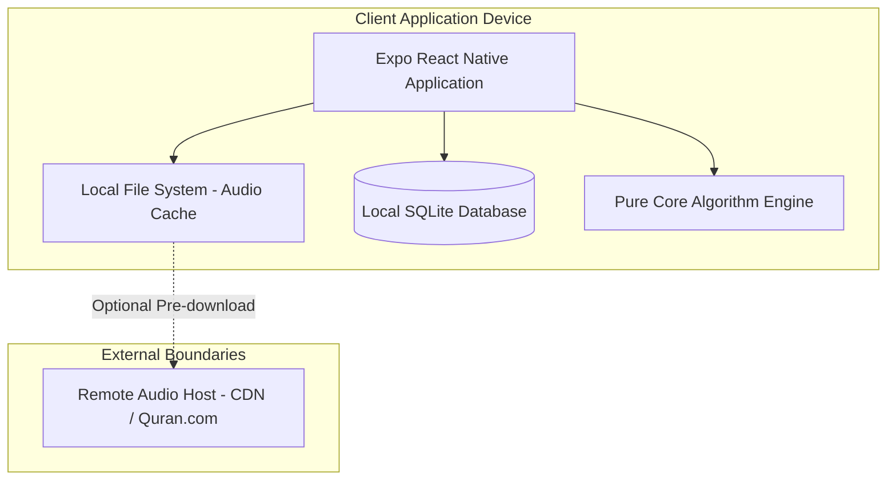
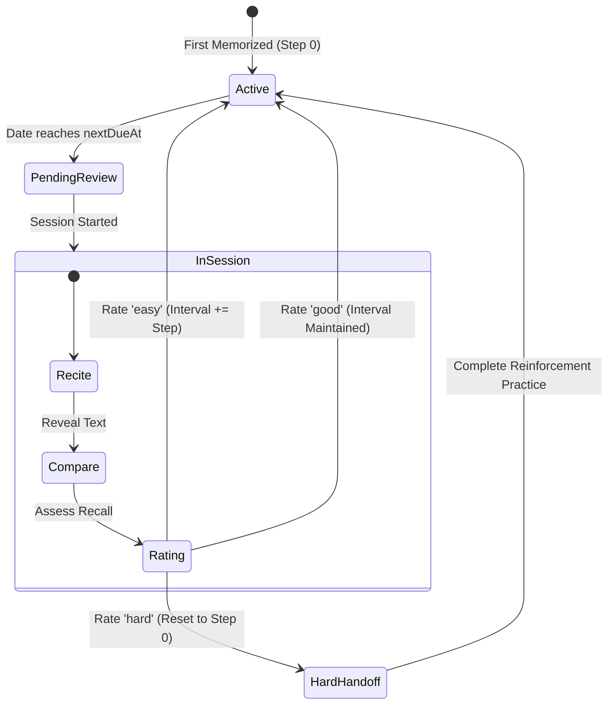
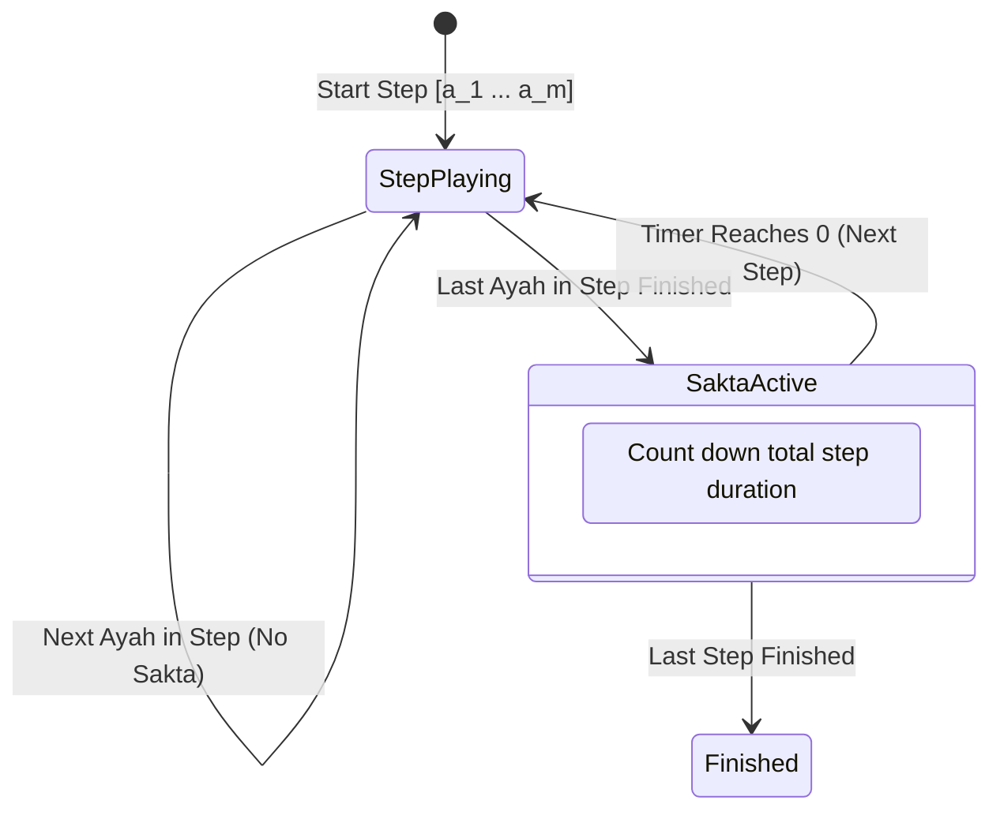
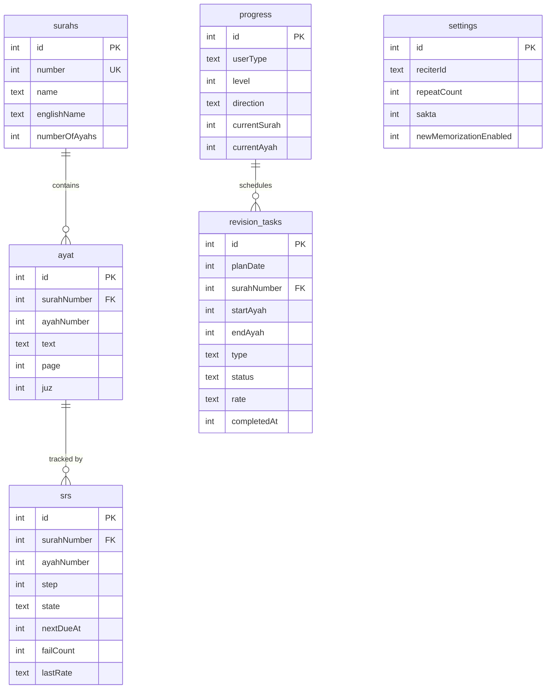

# Iqraa Engineering Specifications Document
### URS (User Requirements) • SyRS (System Requirements) • SRS (Software Requirements)

---

## Table of Contents
1. [Executive Summary & Product Vision](#1-executive-summary--product-vision)
2. [User Requirements Specification (URS)](#2-user-requirements-specification-urs)
   - 2.1 User Personas & Target Demographics
   - 2.2 Core User Journeys & Workflows
   - 2.3 User Needs & Operational Acceptance Criteria
3. [System Requirements Specification (SyRS)](#3-system-requirements-specification-syrs)
   - 3.1 System Boundaries & Scope
   - 3.2 Layered System Architecture
   - 3.3 Non-Functional Requirements (NFRs)
   - 3.4 Hardware & Operating Environment
4. [Software Requirements Specification (SRS)](#4-software-requirements-specification-srs)
   - 4.1 Detailed Functional Requirements
     - [FR-MEM] Accumulative Memorization Module
     - [FR-SRS] Spaced Repetition System Engine
     - [FR-REV] Revision Engine & Task Planning
     - [FR-PLN] Daily Mix & Dynamic Goal Planner
     - [FR-AUD] Audio Engine, Recording & Dynamic Sakta
   - 4.2 Mathematical Algorithms & Formulations
   - 4.3 State Machines & Lifecycle Diagrams
   - 4.4 Data Schema & Entity Relationships (Drizzle ORM)

---

## 1. Executive Summary & Product Vision

**Iqraa (إقرأ)** is an offline-first mobile application designed to guide Muslims through the systematic memorization and retention of the Holy Qur'an. 

The core challenge in Qur'anic memorization is not the initial retention of verses, but rather **forgetting and lack of balanced revision** over time. Iqraa solves this through a dual-engine architecture:
1. **Accumulative Audio Pedagogy**: Teaches new verses in expanding verse clusters with dynamic recitation pauses (*Sakta*) equal to the exact duration of the recited passage.
2. **Cognitive Spaced Repetition System (SRS)**: Employs interval scheduling adapted to Qur'anic verse connectivity, prioritizing forgotten and weak verses while preventing backlog through automatic daily pacing.

---

## 2. User Requirements Specification (URS)

### 2.1 User Personas

| Persona | Definition | Primary Pain Point | Core Expectation |
|---|---|---|---|
| **Beginner (`notHafiz`)** | Starting from scratch or knows short Surahs | High cognitive load, difficulty connecting consecutive verses | 70% focus on new memorization with slow, guided audio repetition and recitation pauses |
| **Intermediate (`partiallyHafiz`)** | Memorized several Juz' but struggles with retention | New memorization pushes old verses out of memory | 60% revision focus with 40% new memorization, dynamic daily balance |
| **Advanced (`hafiz`)** | Memorized all or most of the Qur'an | Retaining large volumes, confusing similar verses (*Mutashabihat*) | 90% revision focus, high daily capacity (up to 100 ayat/day), weak verse prioritization |

---

### 2.2 Core User Journeys

#### Journey A: New Memorization Flow

1. **Step 1 (Listen & Repeat)**: The user listens to an expanding sequence of verses. In each step, the verses are recited continuously without interruption. At the end of the step, a dynamic pause (*Sakta*) counts down, giving the user exact time to repeat the full sequence.
2. **Step 2 (Active Recall / Tasmee)**: The user recites the learned passage from memory without visual text and records their voice.
3. **Step 3 (Compare with Mushaf)**: The user reviews the authentic Uthmani Quranic text while listening back to their recorded recitation to detect mistakes.
4. **Step 4 (Evaluate)**: The user rates their recall (*Good* / *Needs Reinforcement*). A successful rating registers the verses into the Spaced Repetition Engine.

#### Journey B: Daily Revision Flow
1. The user opens the **Revision** dashboard.
2. Today's due verses are pre-grouped into continuous, uninterrupted tasks based on Surah continuity.
3. For each task, the user proceeds through:
   - **Tasmee**: Recite from memory and record.
   - **Compare**: Reveal Quranic text and verify accuracy.
   - **Evaluate**: Choose from 3 calibrated ratings:
     - **Easy (ممتاز)**: Flawless recall; interval expands significantly.
     - **Good (جيد)**: Minor hesitation; interval advances moderately.
     - **Hard (ضعيف)**: Error or blockage; interval resets to Day 1, and the verse is routed to the **Hard Handoff** reinforcement queue.

---

### 2.3 User Needs & Operational Acceptance Criteria

- **UAC-01 (Offline Freedom)**: The user must be able to use 100% of the memorization, revision, audio playback, and scheduling features without an internet connection.
- **UAC-02 (Natural Recitation Continuity)**: Within any accumulative step, consecutive verses must play seamlessly back-to-back with zero delay between them.
- **UAC-03 (Accurate Repetition Window)**: The silence pause (*Sakta*) must match the exact cumulative playback time of the preceding step, allowing adequate time to recite.
- **UAC-04 (No Fragmented Revision)**: Consecutive due verses within the same Surah must be presented as a single cohesive recitation task.

---

## 3. System Requirements Specification (SyRS)

### 3.1 System Boundaries & Scope

- **Zero Cloud Runtime**: The application runtime does not depend on any cloud backend, user authentication server, or remote database.
- **Data Boundary**: All user state, progress metrics, SRS records, and revision schedules reside exclusively in a local SQLite file (`iqraa_v5.db`).
- **Media Boundary**: Reciter audio files are streamed or cached locally. Once cached, playback is entirely local.

### 3.2 Layered System Architecture

The codebase strictly enforces unidirectional layer isolation:
$$\text{Screen} \longrightarrow \text{Hook} \longrightarrow \text{Service} \longrightarrow \text{Repository} \longrightarrow \text{SQLite}$$

1. **Presentation Layer (`src/components`, `src/app`)**: UI components and Expo Router screens. Never imports database code.
2. **Hook Layer (`src/hooks`)**: Manages UI state subscriptions and triggers service actions.
3. **Service Layer (`src/services`)**: Orchestrates business logic, combines repositories, and wraps multi-table operations in atomic SQLite transactions.
4. **Data Access Layer (`src/db/repositories`)**: Type-safe queries using Drizzle ORM.
5. **Pure Core Layer (`src/core`)**: Zero dependencies on React, React Native, or SQLite. Pure, deterministic TypeScript functions. Callers pass explicit timestamps (`now: number`).

### 3.3 Non-Functional Requirements (NFRs)

- **NFR-PERF-01 (Database Speed)**: All query operations on daily tasks and SRS item lookups must execute in under **50 ms**.
- **NFR-PERF-02 (Audio Gapless Transition)**: Inter-ayah gap during consecutive playback within a single step must be less than **15 ms**.
- **NFR-RELIABILITY-01 (Atomicity)**: Multi-record mutations (such as evaluating a revision task touching both `revision_tasks` and `srs`) must use an atomic database transaction (`withTransaction`).
- **NFR-USABILITY-01 (Arabic & RTL)**: The application must support right-to-left layout direction, high-legibility Uthmani typography, and accessible color tokens.

### 3.4 Hardware & Operating Environment

- **Target Platforms**: iOS 14.0+, Android 8.0+ (API Level 26+).
- **Core Runtime**: React Native 0.76+ via Expo SDK 52.
- **Storage Engine**: `expo-sqlite` with Drizzle ORM.
- **Audio Engine**: `expo-audio` with native background audio modes.

---

## 4. Software Requirements Specification (SRS)

### 4.1 Detailed Functional Requirements

#### [FR-MEM] Accumulative Memorization Module
- **FR-MEM-01**: The system shall generate accumulative steps for any sequence of verse numbers $A = [a_1, a_2, \dots, a_n]$ via:
  $$\text{Steps}(A) = \left\{ A[0 \dots k] \;\middle|\; 0 \le k < n \right\}$$
- **FR-MEM-02**: During any step $S = [a_1, \dots, a_m]$, the audio player shall automatically sequence from $a_1$ through $a_m$ without triggering a Sakta pause.
- **FR-MEM-03**: The Sakta pause shall be triggered if and only if the final verse $a_m$ in step $S$ completes playback.
- **FR-MEM-04**: The Sakta duration $D_{\text{sakta}}$ shall be calculated as:
  $$D_{\text{sakta}} = \max\left(1, \; \text{round}\left(\sum_{k=1}^{m} \text{Duration}(a_k)\right)\right)$$
- **FR-MEM-05**: The UI shall display a real-time countdown timer during Sakta with instant manual skip and cancel controls.

#### [FR-SRS] Spaced Repetition System Engine
- **FR-SRS-01**: The intervals ladder for consecutive review successes shall be:
  $$I = [1, \; 3, \; 7, \; 15, \; 30, \; 60, \; 90] \quad (\text{days})$$
- **FR-SRS-02**: Rating evaluation transitions:
  - **`easy`**: $\text{step} \leftarrow \min(\text{step} + 1, \; \text{length}(I) - 1)$
  - **`good`**: $\text{step} \leftarrow \text{step}$ (or moderate increment)
  - **`hard`**: $\text{step} \leftarrow 0$, $\text{failCount} \leftarrow \text{failCount} + 1$, and immediate routing to reinforcement.
- **FR-SRS-03**: Schedule timestamp formulation:
  $$\text{nextDueAt} = \text{startOfDayAfter}(\text{now}, \; I[\text{step}])$$

#### [FR-REV] Revision Engine & Task Planning
- **FR-REV-01**: Items due for revision are selected where $\text{nextDueAt} \le \text{startOfDayAfter}(\text{now}, 0) + 86400000$.
- **FR-REV-02**: Sorting priority:
  1. Descending by `failCount` (weakest verses first).
  2. Ascending by `step` (less established memory first).
  3. Directional recitation order (`progress.direction`: ascending $1 \to 114$ or descending $114 \to 1$).
- **FR-REV-03**: Continuous task grouping: Consecutive verses in the same Surah must be consolidated into a single continuous task draft $[a_{\text{start}} \dots a_{\text{end}}]$.

#### [FR-PLN] Daily Mix & Dynamic Goal Planner
- **FR-PLN-01**: Daily quota allocation:
  - `notHafiz`: 70% New Memorization / 30% Revision (Max 30 ayat/day)
  - `partiallyHafiz`: 40% New Memorization / 60% Revision (Max 60 ayat/day)
  - `hafiz`: 10% New Memorization / 90% Revision (Max 100 ayat/day)
- **FR-PLN-02**: Backlog throttling: If overdue revision count exceeds 15 ayat, new memorization quota is automatically halved until backlog clears.

---

### 4.2 Mathematical Algorithms & Formulations

#### 1. Daily Quota Allocation Formula
Given total daily ceiling $C$, user type split ratio $r_{\text{rev}}$, and overdue backlog $B$:
$$\text{RevisionShare} = \min\left(C \times r_{\text{rev}}, \; B\right)$$
$$\text{NewShare} = \begin{cases} 
\min\left(C - \text{RevisionShare}, \; C \times (1 - r_{\text{rev}})\right) & \text{if } B \le 15 \\
\min\left(C - \text{RevisionShare}, \; \frac{C \times (1 - r_{\text{rev}})}{2}\right) & \text{if } B > 15
\end{cases}$$

#### 2. Revision Selection Priority Metric
For each candidate due item $i$, sorting rank is determined by the tuple:
$$\text{Priority}(i) = \Big( -\text{failCount}_i, \; \text{step}_i, \; \text{order}(\text{surahNumber}_i, \text{direction}), \; \text{ayahNumber}_i \Big)$$

---

### 4.3 State Machines & Lifecycle Diagrams

#### SRS Item Progression Lifecycle

#### Accumulative Listening Step Transition

---

### 4.4 Data Schema & Entity Relationships (Drizzle ORM)

